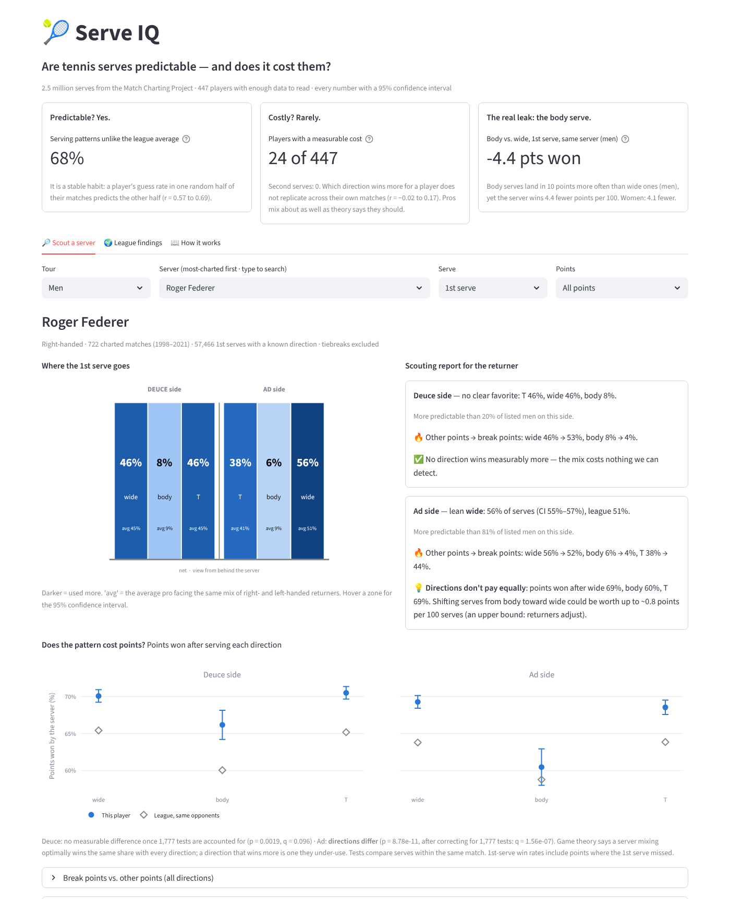

# 🎾 Serve IQ

**Are tennis serves predictable — and does it cost them?**

An interactive dashboard built on 2.56 million charted professional serves. Pick any of 447 players (men and
women) to see where they serve on each side of the court, how that compares to the league, how it changes on
break points, and whether their pattern actually costs them points. Every number comes with a 95% confidence
interval.



## The answer

| Question | Answer | Evidence |
|---|---|---|
| **Are serves predictable?** | **Yes.** Most servers have a recognisable habit. | 68% of player × court-side serving patterns (1st serves) differ from the league average for the same opponents. The habit is stable: a player's "guess rate" in one random half of their matches predicts the other half (r = 0.57–0.69). |
| **Does it cost them?** | **Rarely.** | Only 24 of 447 players have a court side where some 1st-serve direction wins measurably more than the others, and none on 2nd serves. Which direction pays better for a player does not replicate across their own matches (r = −0.02 to 0.17). Pros mix about as well as game theory says they should. |
| **So where are points lost?** | **The body serve.** | Comparing serves by the same server on the same side, body serves land in about 10 points more often than wide ones, yet the server wins 4.4 fewer points per 100 (men; women 4.1). |
| **Does pressure change it?** | **A little.** | On break points servers go wide about 1–2 points more often. 62 player × side × serve patterns show a significant shift (e.g. Nadal's deuce-side wide serve: 30% → 45%). |

The honest headline: **pros are predictable, but that predictability almost never costs them anything we can
measure.** The dashboard shows which players are the exceptions and gives a returner the scouting report.

## What's in the dashboard

- **Scout a server:** a court diagram of where the serve goes (deuce and ad side), compared with the league
  average for the same mix of right- and left-handed returners; a returner's scouting report (favourite
  direction, break-point habits, whether any direction pays measurably better); points won by direction with
  confidence intervals.
- **League findings:** direction mix and win rates by matchup; the body-serve gap; break-point shifts; the
  split-half test showing predictability is a trait and its cost is noise; serial patterns.
- **How it works:** methods and limits in plain English.

## Run it

```bash
python -m venv .venv && source .venv/bin/activate
pip install -r requirements.txt
streamlit run app/streamlit_app.py
```

The app reads only the small precomputed tables in `app/data/` (1.5 MB), so it runs without the raw data.
Tested on Python 3.9 and 3.12.

**Deploy:** on [share.streamlit.io](https://share.streamlit.io), create an app from this repository with main
file `app/streamlit_app.py`.

## Rebuild everything from the raw data

```bash
git clone https://github.com/JeffSackmann/tennis_MatchChartingProject data   # raw charting files
python src/build_serves.py   # -> output/serves.parquet: one row per serve (2.56M rows)
python src/reconcile.py      # check against the project's own serve-direction totals
python src/baseline.py       # league-wide baseline with two-way clustered CIs
python src/app_data.py       # -> app/data/: per-player tables and tests for the app
```

## Method

- **One row per serve.** Each charted point gives a 1st serve and, if it missed, a 2nd serve. Direction
  (wide / body / T), in or fault, score, court side, break point, who won the point, and both players'
  handedness. Cleaning steps (duplicate charts, slips in the codes, swapped handedness labels, no-ad deciding
  points) are documented in `src/build_serves.py` and print their counts when run.
- **Verified.** Totals match the project's own per-match serve-direction stats exactly for 98.7–99.6% of
  player-matches (the rest differ by a serve or two, mostly where we treat a point differently on purpose,
  e.g. no-ad deciding points, where the court is unknown). An independent re-parse of every serve code
  agreed on every direction, and 30 random points were checked by hand.
- **Fair comparisons.** Deuce and ad side are always separate. A player is compared with the league average
  re-weighted to their own mix of right- and left-handed opponents.
- **The payoff of a 1st serve** is the whole point, including points where the 1st serve missed
  (Walker & Wooders 2001). Game theory says an optimal server wins the same share with every direction.
- **Uncertainty.** Shares and win rates have 95% CIs clustered by match (the wider of clustered and binomial).
  League CIs are two-way clustered by server and returner.
- **No cherry-picking.** Per-player tests (does a direction pay better? did the pattern shift on break points?)
  are Cochran–Mantel–Haenszel tests that compare serves within the same match, with Benjamini–Hochberg
  false-discovery-rate control at 5% across all 1,777–5,364 tests per family. Calibration check: shuffling
  labels within matches gives 5.0% of tests at p < 0.05 and zero discoveries after correction.
- **Stable or noise?** Each player's matches are split at random into halves; real traits replicate.

## Limits

- Charted matches are chosen by volunteers: mostly big matches of well-known players, not a random sample.
- Win rate by direction is observational. A server may choose a direction *because* of the returner's
  position, and returners would adapt to any change, so "could be worth" figures are upper bounds.
- No measurable cost is not proof of zero cost: an edge of about one point per 100 serves needs far more data
  per player than exists.
- Tiebreak points (3%), serves with no recorded direction (0.2%) and no-ad deciding points are excluded.

## Repository

```
app/streamlit_app.py   the dashboard
app/data/              precomputed tables the app reads (CC BY-NC-SA 4.0, see below)
src/build_serves.py    raw charting files -> one row per serve
src/reconcile.py       checks the rebuild against the project's own totals
src/baseline.py        league-wide baseline, clustered CIs, within-server effects
src/app_data.py        per-player tables, tests and stability checks for the app
```

## Data and license

Data: [The Tennis Abstract Match Charting Project](https://github.com/JeffSackmann/tennis_MatchChartingProject)
by Jeff Sackmann and contributors, licensed
[CC BY-NC-SA 4.0](https://creativecommons.org/licenses/by-nc-sa/4.0/). The derived tables in `app/data/`
are shared under the same license. Non-commercial use only.
